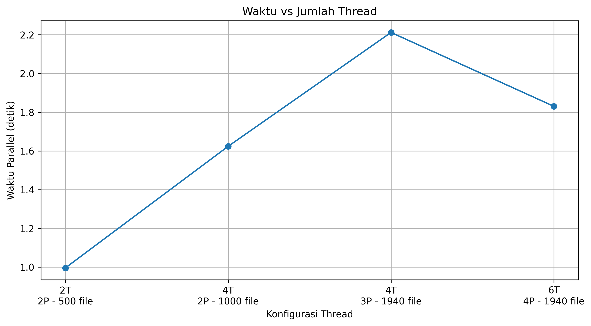
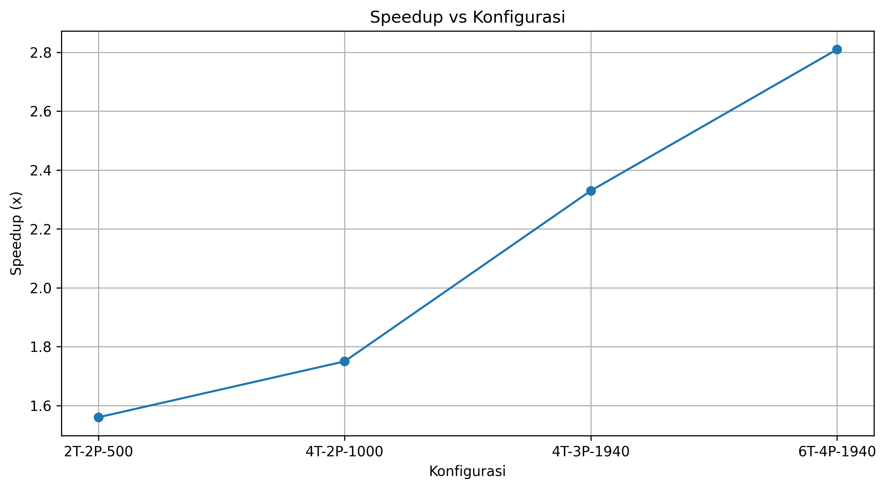

# Parallel File Analyzer

A hybrid parallel Python application for analyzing thousands of text files quickly. Built as a UTS (midterm exam) project for the KPT course.

It demonstrates when to use **Threads for I/O-bound work** and **Processes for CPU-bound work** in the same pipeline.

## Features

- Hybrid parallelism: `ThreadPoolExecutor` + `ProcessPoolExecutor`
- Text analysis per file: characters, words, lines, vowels, digits, symbols
- Serial vs. parallel benchmark: execution time, throughput, speedup, efficiency
- Visualization with `matplotlib`
- Reproducible dataset (`random.seed = NPM`)

## Project Structure

```
UTS/
├── data_generator.py  # Generates 1940 txt files (~20KB each) into data/
├── analyzer.py        # Core analyze_text() logic
├── main.py            # Main run (4 threads, 3 processes, 1940 files)
├── benchmark.py       # Serial vs. parallel comparison, saves to results.csv
├── plot.py            # Generates charts from results.csv into grafik/
├── results.csv        # Benchmark results
├── data/              # Dataset: file_0001.txt ... file_1940.txt
└── grafik/            # Charts: waktu_vs_thread, waktu_vs_process, speedup
```

### File descriptions

| File | Purpose |
|------|---------|
| `data_generator.py` | Generates `TOTAL_FILES = 1940` files of `~20KB` each. Each line randomly mixes words (70%), numbers (20%), and symbols (10%). |
| `analyzer.py` | `analyze_text(text)` counts characters (`len`), words (`[A-Za-z]+`), lines (`splitlines`), vowels, digits, and symbols. |
| `main.py` | Reads all files with Threads, analyzes with Processes, aggregates totals, prints total stats + elapsed time + throughput. |
| `benchmark.py` | Same pipeline as `main.py` but runs both serial and parallel, validates results are identical, calculates speedup/efficiency, appends a row to `results.csv`. Accepts `--threads`, `--processes`, `--files`. |
| `plot.py` | Reads `results.csv` and generates 3 PNG charts in `grafik/`. |
| `results.csv` | Stores `threads,processes,files,serial_time,parallel_time,serial_throughput,parallel_throughput,speedup,efficiency`. |
| `data/` | Input dataset (1940 files). |
| `grafik/` | Output charts. |

## Requirements

- Python 3.10+
- matplotlib (only external dependency, used by `plot.py`)

```bash
pip install matplotlib
```

No `requirements.txt` needed — the standard library covers everything else (`concurrent.futures`, `pathlib`, `argparse`, `csv`, `re`).

## How to Run

```bash
# 1. Clone the repo
git clone <your-repo-url>
cd UTS

# 2. Install dependency for plotting
pip install matplotlib

# 3. Generate the dataset (required before anything else)
python data_generator.py
# Output: data/file_0001.txt ... data/file_1940.txt

# 4. Main run
python main.py

# 5. Benchmark (serial vs parallel)
python benchmark.py --threads 4 --processes 3 --files 1940

# 6. Generate charts
python plot.py
```

### CLI options for `benchmark.py`

```bash
python benchmark.py --threads 6 --processes 4 --files 1940
python benchmark.py --threads 2 --processes 2 --files 500
```

- `--threads`: number of threads for file reading (min 1, default 4)
- `--processes`: number of processes for text analysis (min 1, default 3)
- `--files`: number of files to analyze (1–1940, default 1940)

## Example

Sample input (`data/file_0001.txt`):

```
process computing file technology process 7366 execution information thread 91 ...
python data , 619 9833 7250 analysis parallel algorithm process software ...
```

Sample output (`main.py`):

```
========================================
       PARALLEL FILE ANALYZER
========================================
NPM              : 247006111194
Jumlah file      : 1940
Jumlah thread    : 4
Jumlah process   : 3
========================================

HASIL ANALISIS
----------------------------------------
Total karakter : ...
Total kata     : ...
Total baris    : ...
Total vokal    : ...
Total angka    : ...
Total simbol   : ...

PERFORMA
----------------------------------------
Waktu total    : ~2.21 detik
Throughput     : ~877.00 file/detik
```

Sample output (`benchmark.py`):

```
============================================================
              PARALLEL FILE ANALYZER
                 PERFORMANCE TEST
============================================================
Waktu serial       : 5.15 detik
Waktu parallel     : 2.21 detik
Throughput serial  : 376.59 file/detik
Throughput parallel: 877.00 file/detik
Speedup            : 2.33x
Efisiensi hybrid   : 33.27%
Validasi hasil     : BERHASIL
Hasil disimpan     : results.csv
```

## Benchmark Results

Current `results.csv`:

| Threads | Processes | Files | Serial (s) | Parallel (s) | Serial (file/s) | Parallel (file/s) | Speedup | Efficiency (%) |
|---------|-----------|-------|------------|--------------|-----------------|-------------------|---------|----------------|
| 2 | 2 | 500 | 1.5578 | 0.9961 | 320.97 | 501.95 | 1.56x | 39.10 |
| 4 | 2 | 1000 | 2.8356 | 1.6242 | 352.65 | 615.70 | 1.75x | 29.10 |
| 4 | 3 | 1940 | 5.1515 | 2.2121 | 376.59 | 877.00 | 2.33x | 33.27 |
| 6 | 4 | 1940 | 5.1509 | 1.8307 | 376.64 | 1059.70 | 2.81x | 28.14 |

Best config so far: **6 threads + 4 processes on 1940 files → 2.81x speedup, ~1059 files/sec.**

### Charts





Regenerate after adding new benchmark rows:

```bash
python plot.py
```

## How It Works

```
data/*.txt
    │
    ▼ ThreadPoolExecutor (I/O-bound: fast file reads, no GIL issue)
list of texts
    │
    ▼ ProcessPoolExecutor (CPU-bound: regex + counting, bypasses GIL)
list of dicts {characters, words, lines, vowels, digits, symbols}
    │
    ▼ aggregate_results()
totals + perf_counter() timing
```

Why hybrid?
- File reading is **I/O-bound** → threads are lightweight and efficient.
- Text analysis (`re.findall`, per-character loops) is **CPU-bound** → processes use multiple CPU cores and avoid Python's GIL.

## Author

**Chandra AdiPraja** — NPM 247006111194 — Class G
